# FreshCart: E-commerce Web Application

A modern, fully responsive e-commerce storefront built with **Next.js (App Router)** and **TypeScript**. Users can browse products, search and filter, manage a cart and wishlist, check out with cash or online payment, track orders, and manage their profile, in both **light and dark themes**.

The project focuses on server-side data fetching with caching, secure authentication, polished UI/UX, and reusable components.

**[Live Demo](https://e-commerce-yc2t.vercel.app)**
**[GitHub Repository](https://github.com/menna-hedia/E-commerce)**

---

## Screenshots

Every page supports light, dark and system themes.

| Page | Light | Dark |
| --- | --- | --- |
| **Home** | 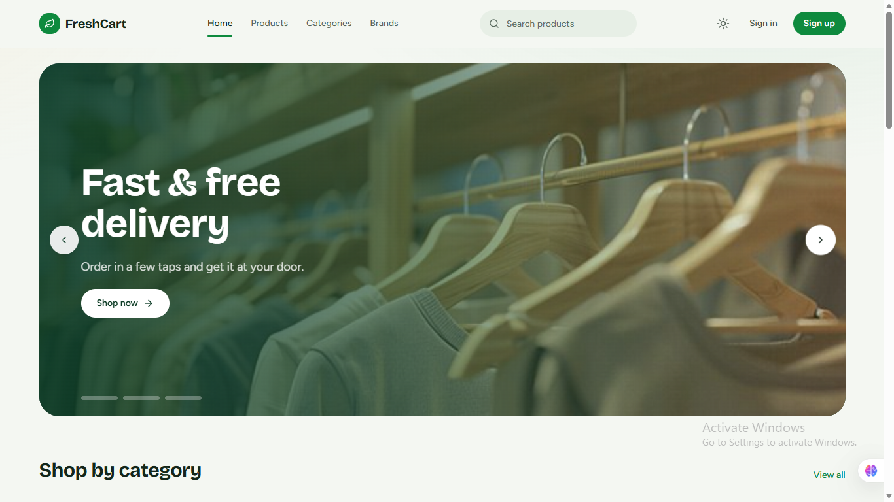 | 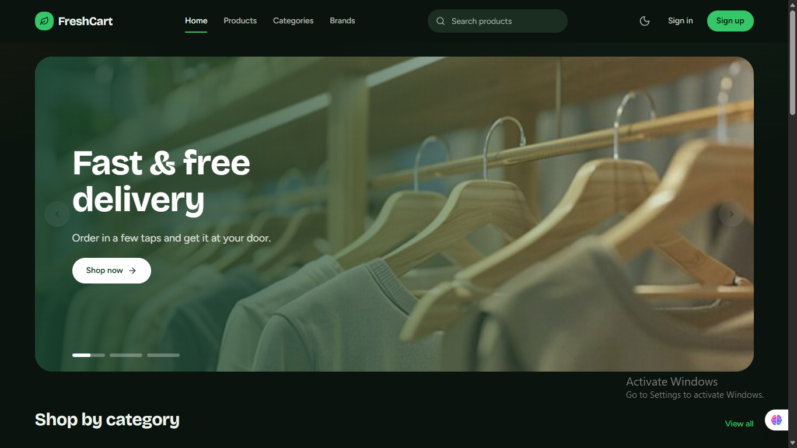 |
| **Products** | 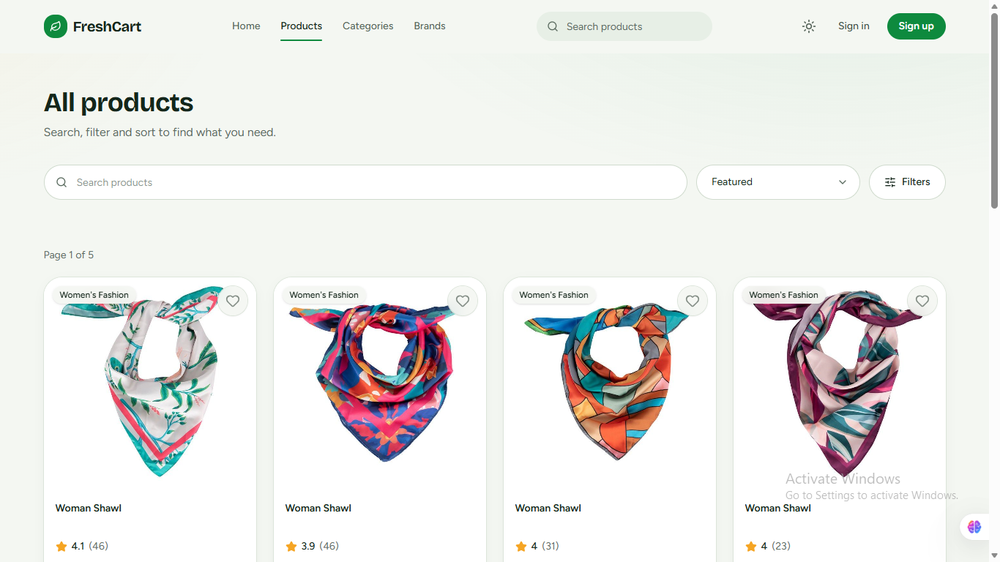 | 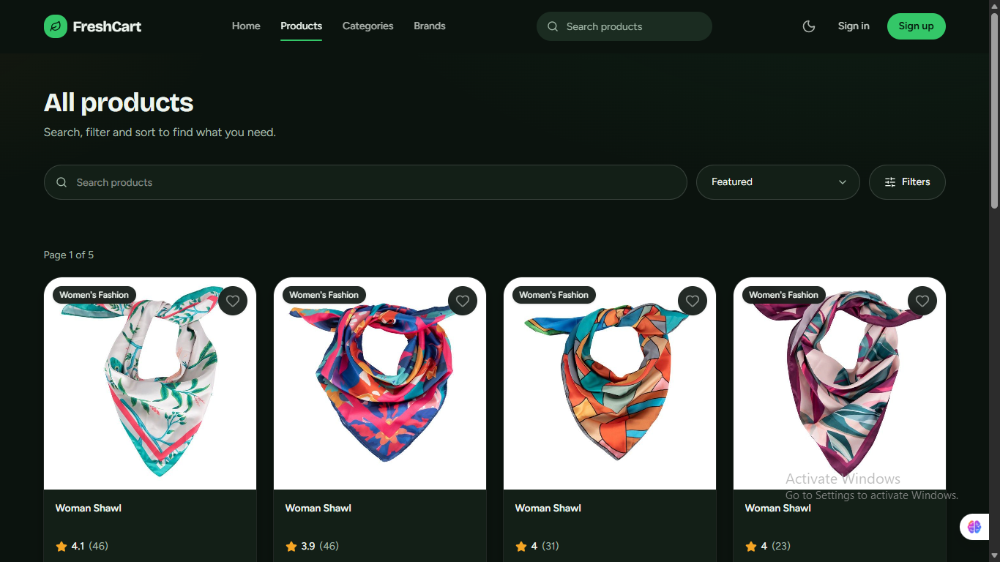 |
| **Product Details** | 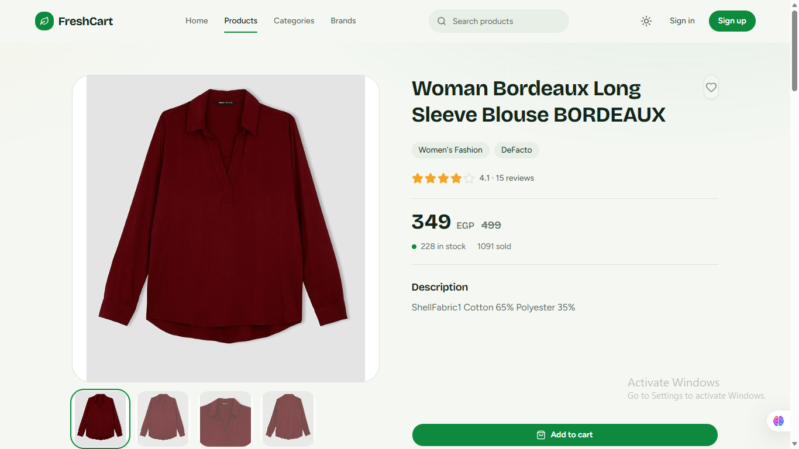 | 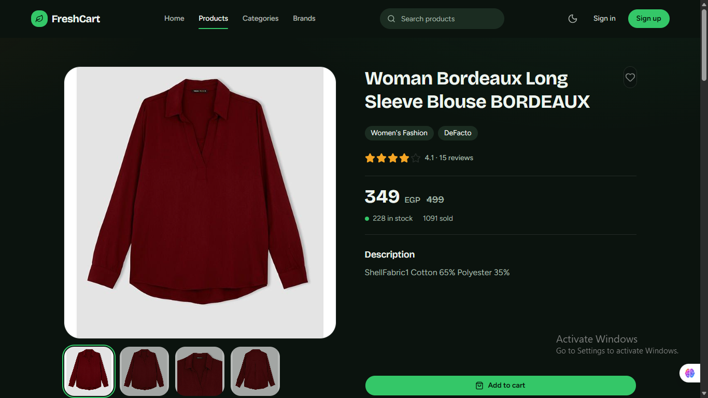 |
| **Cart** | 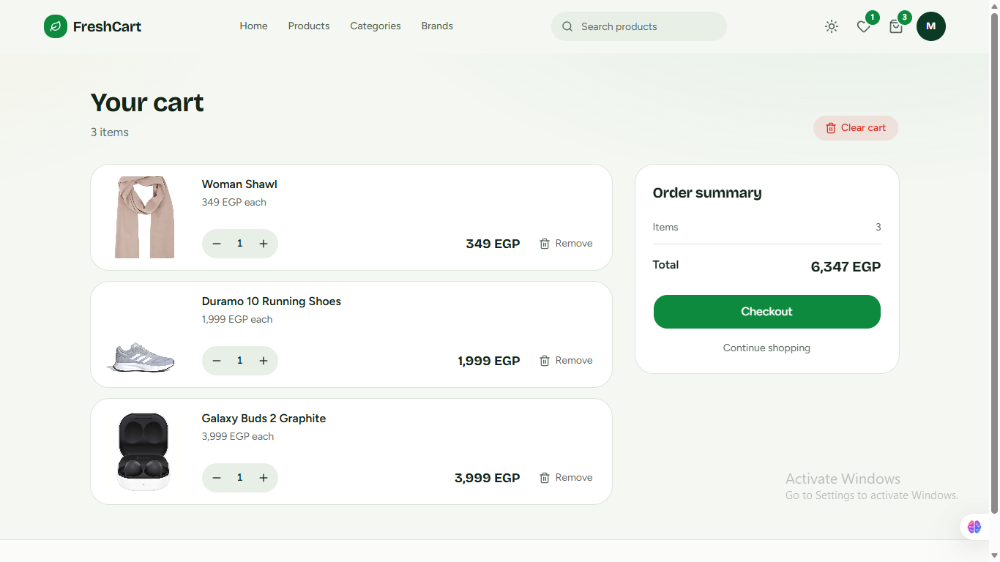 | 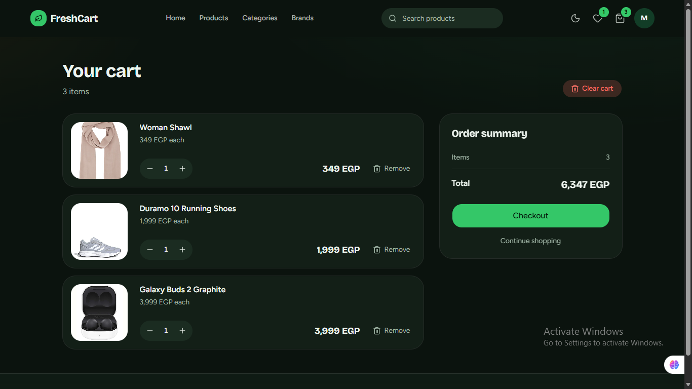 |
| **Checkout** | 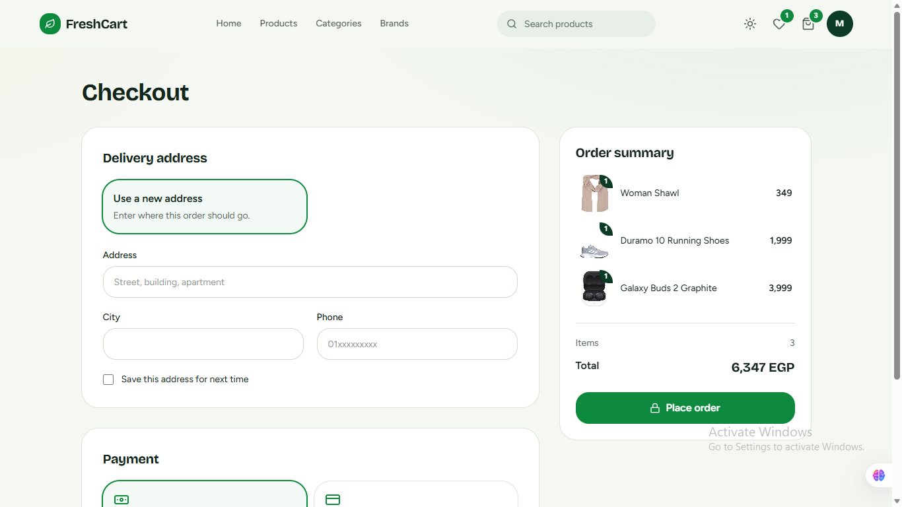 | 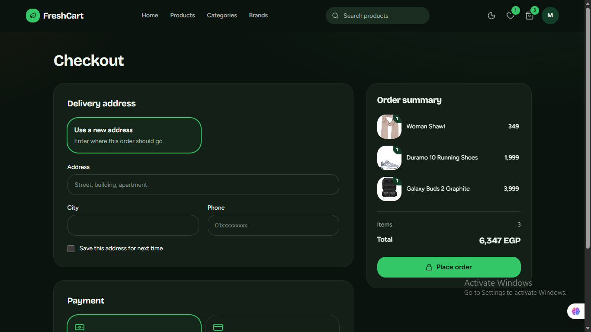 |
| **Orders** | 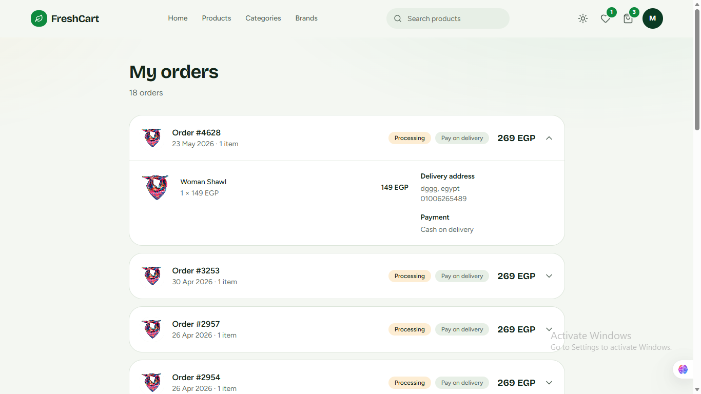 | 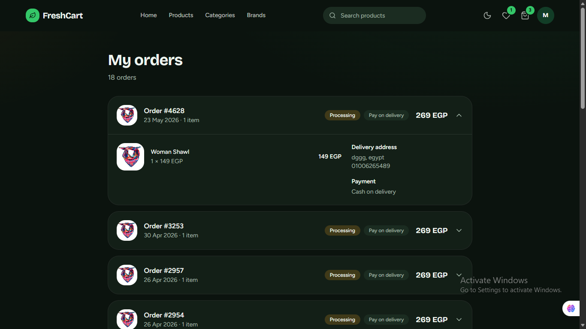 |
| **Profile** | 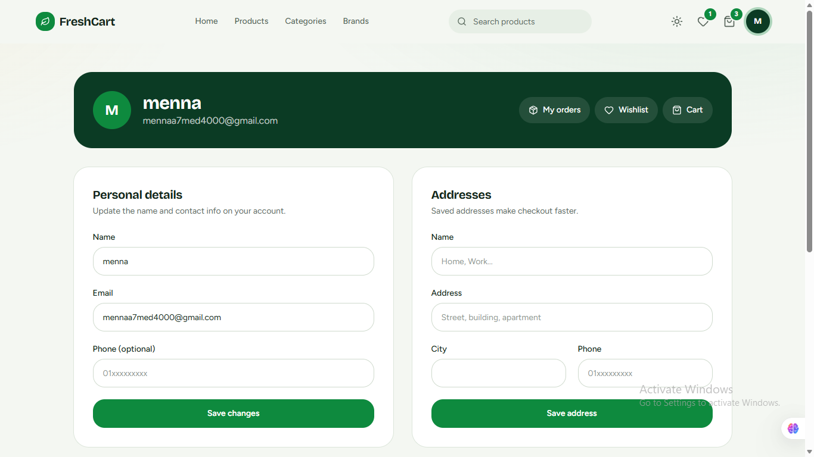 | 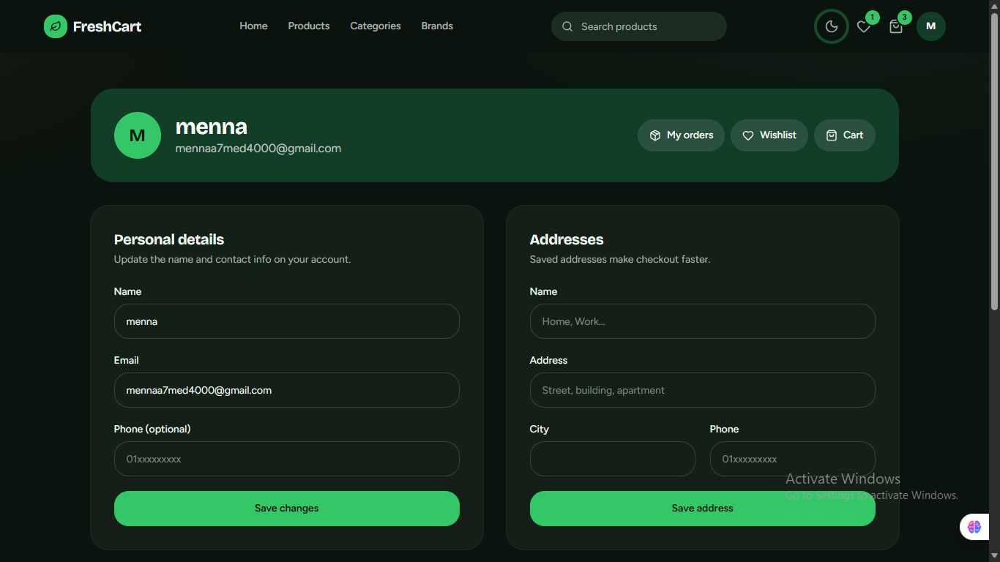 |
| **Login** | 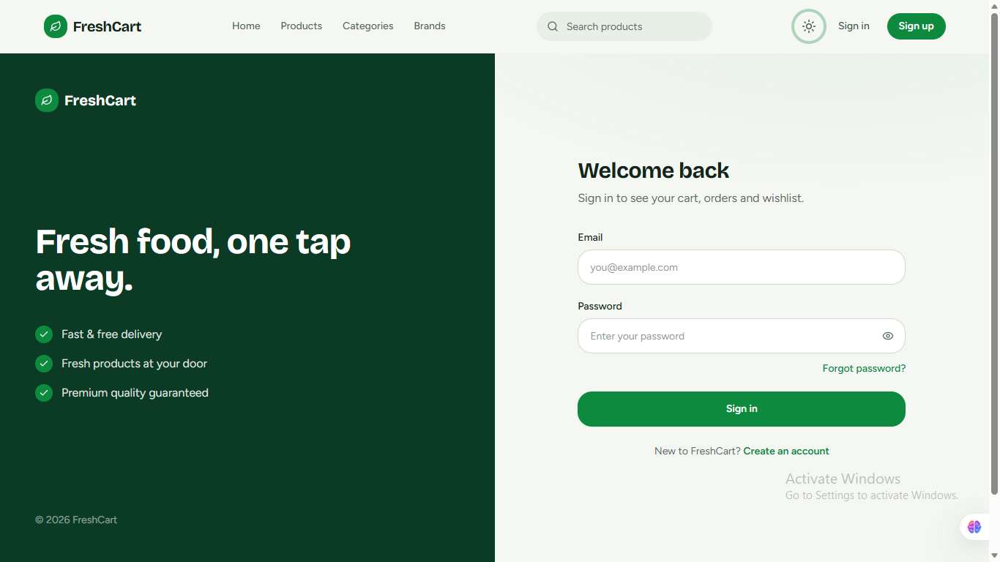 | 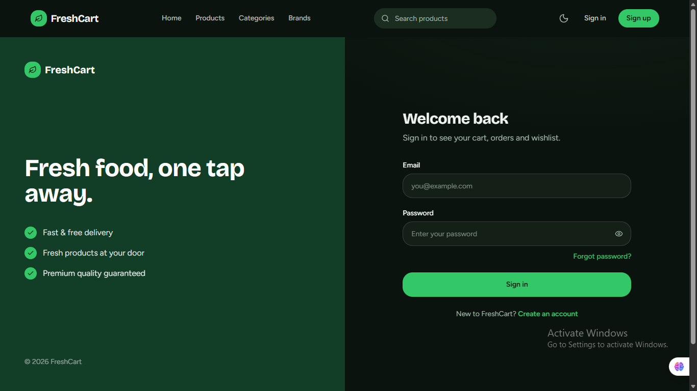 |

---

## Table of Contents

* [Overview](#overview)
* [Features](#features)
* [Technical Highlights](#technical-highlights)
* [Tech Stack](#tech-stack)
* [Project Structure](#project-structure)
* [Getting Started](#getting-started)
* [Available Scripts](#available-scripts)
* [Environment and API](#environment-and-api)
* [Future Improvements](#future-improvements)
* [Author](#author)
* [License](#license)

---

## Overview

FreshCart gives shoppers a complete buying experience: discover products through categories, brands and search, save favorites, build a cart, pay, and follow their orders afterwards.

The application integrates with the **Route E-commerce API** for authentication, products, cart, orders, reviews and addresses.

---

## Features

### 1. Authentication and Access Control

* **User Registration:** Sign up with name, email, phone and password, with full form validation.
* **Secure Sign In:** JWT-based authentication through NextAuth.
* **Password Reset:** A 3-step flow: enter your email, verify the code, choose a new password.
* **Protected Routes:** Cart, orders, wishlist and profile are restricted to signed-in users, and you return to the page you were visiting after signing in.
* **Custom 404 and Error Pages:** Dedicated pages for missing routes and unexpected errors.

### 2. Catalog and Discovery

* **Products Page:** Live search, sorting, and filters for category, brand and price range, with pagination.
* **Category and Brand Pages:** Each shows its own products, and categories also list their sub categories.
* **Product Details:** Image gallery, discount pricing, stock status, and related products.
* **Search Everywhere:** A search box in the navbar on desktop and mobile.

### 3. Cart and Checkout

* Add to cart from any product card, with loading and success feedback.
* Change quantities, remove items, or clear the cart.
* Choose a saved address or enter a new one, and optionally save it for next time.
* Pay with **cash on delivery** or **online (Stripe)**, with an order summary beside the form.

### 4. Orders

* Order history with delivery and payment status.
* Expandable details for each order: items, delivery address and payment method.
* Stripe returns to `/allorders`, which redirects to the orders page.

### 5. Wishlist and Reviews

* Add and remove favorites with one tap, with a count badge in the navbar.
* Write, edit and delete your own product review.
* Rating summary with a star breakdown.

### 6. Profile Management

* Update your name, email and phone.
* Change your password.
* Add and remove delivery addresses.

### 7. Theming and User Experience

* **Light, Dark and System** themes with a toggle in the navbar and no flash on load.
* Fully responsive layout with a mobile menu.
* Skeleton loaders, empty states and error states across all pages.
* Toast notifications for every action.
* Scroll reveal and page transition animations, with `prefers-reduced-motion` support.

---

## Technical Highlights

### Server-Side Rendering and Caching
* Server Components fetch data on the server, so pages arrive with content.
* Public data is cached: products for 5 minutes, categories and brands for 1 hour.
* Signed-in data (cart, wishlist, orders, addresses) is never cached.

### Streaming
* The home and products pages stream the ready parts first, with skeletons for the rest.
* Independent requests run in parallel with `Promise.all`.

### Authentication and Route Protection
* NextAuth with a credentials provider and JWT sessions.
* Middleware protects private routes and keeps the `callbackUrl`, accepting local paths only.
* Server actions read the session token, so the API token never reaches the browser.

### Theming
* Colors are CSS variables in `globals.css`: `:root` holds the light palette and `.dark` holds the dark one.
* A `--brand-foreground` token keeps text readable on green backgrounds in both themes.
* `next-themes` stores the choice and follows the operating system by default.

### Forms
* React Hook Form with Zod schemas for login, registration, profile, password and addresses.
* Inline error messages with a shake animation.

### Component-Based Architecture
* Reusable components such as `ProductCard`, `ProductGrid`, `Pagination`, `FormField`, `EmptyState` and `Reveal`.
* Server actions grouped by feature in `*.actions.ts` files.

---

## Tech Stack

| Category | Technologies |
| --- | --- |
| Framework | Next.js (App Router), React |
| Language | TypeScript |
| Styling | Tailwind CSS v4, shadcn/ui |
| Authentication | NextAuth.js, JWT, jwt-decode |
| Form Management | React Hook Form, Zod |
| Theming | next-themes |
| Notifications | Sonner |
| Icons | Lucide React |
| API Communication | Fetch, REST API, Server Actions |
| Deployment | Vercel |

---

## Project Structure

```text
src/
├── api/
│   ├── services/routeServices.ts   # Cached public GETs and authenticated GETs
│   ├── authedRequest.ts            # Requests that send the user's token
│   └── types.ts                    # Shared TypeScript types
├── app/
│   ├── (Auth)/                     # login, register, forgot-password
│   ├── _components/                # Navbar, ProductCard, ThemeToggle, FormField...
│   ├── _context/                   # Cart context
│   ├── products/                   # Listing, details and reviews actions
│   ├── categories/  brands/        # Catalog pages
│   ├── cart/                       # Cart page and checkout
│   ├── orders/  allorders/         # Orders and the Stripe return route
│   ├── wishlist/  profile/
│   ├── error.tsx  not-found.tsx  loading.tsx  template.tsx
│   ├── globals.css                 # Design tokens, themes and animations
│   └── layout.tsx
├── components/ui/                  # shadcn/ui components
├── lib/utils.ts
├── nextAuth/nextAuth.config.ts     # Auth configuration
└── middleware.ts                   # Route protection
```

---

## Getting Started

### Prerequisites

* [Node.js](https://nodejs.org/) version 20 or later
* npm (included with Node.js)
* Git

### Installation

```bash
# 1. Clone the repository
git clone https://github.com/<USERNAME>/<REPO>.git

# 2. Navigate to the project directory
cd <REPO>

# 3. Install dependencies
npm install

# 4. Create the environment file (see the next section)

# 5. Start the development server
npm run dev
```

Then open http://localhost:3000 in your browser.

---

## Available Scripts

| Command | Description |
| --- | --- |
| `npm run dev` | Start the development server |
| `npm run build` | Create an optimized production build |
| `npm run start` | Run the production build |
| `npm run lint` | Run ESLint |

---

## Environment and API

Create a `.env.local` file in the project root:

```env
NEXTAUTH_SECRET=your-long-random-secret
NEXTAUTH_URL=http://localhost:3000
```

Generate a secret with `openssl rand -base64 32`. Never commit `.env*` files.

FreshCart uses the **Route E-commerce API**.

**Base URL:** `https://ecommerce.routemisr.com`

Authenticated requests send the JWT through the `token` HTTP header, from the server only.

The API covers:

* Registration, login and password reset
* Products, categories, sub categories and brands
* Cart, wishlist and addresses
* Reviews
* Orders and Stripe checkout sessions

Protected routes: `/cart`, `/orders`, `/allorders`, `/wishlist`, `/profile`.

---

## Future Improvements

* Move the API base URL into an environment variable instead of the service files.
* Add unit and component tests.
* Add end-to-end tests for sign in, checkout and orders.
* Improve accessibility with a full keyboard and screen-reader audit.
* Add product image zoom and a recently viewed list.
* Add multi-language support, including Arabic with RTL layout.

---

## Author

**Menna Hedia**
Frontend Developer | Computer Science Graduate

* **GitHub:** [@menna-hedia](https://github.com/menna-hedia)
* **LinkedIn:** [Menna Hedia](https://www.linkedin.com/in/menna-hedia-1176b924b/)

---

## License

This project was developed for learning, practice, and portfolio purposes.